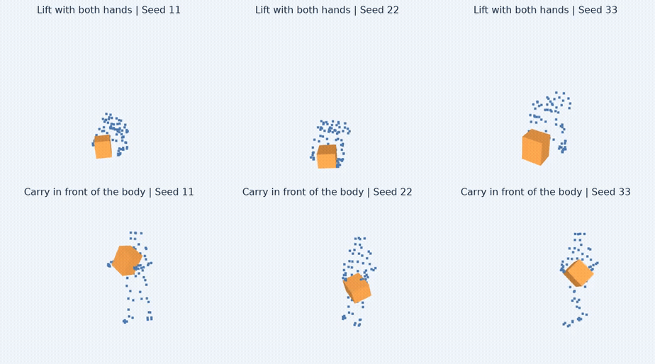

# Plan for generating new data with InterAct

The goal is to generate synthetic human–object interaction sequences and save them in `InterAct/custom_data`. The main workflow is **Text2Interaction**, which uses text and object geometry to generate human and object motion. The original experiment used InterAct revision `ee40b67`.

## Clone InterAct and create `custom_data`

Run these commands from the directory where you want to put the InterAct checkout.

```bash
git clone https://github.com/wzyabcas/InterAct.git
cd InterAct
git checkout --detach ee40b67
mkdir -p custom_data
git clone https://github.com/badriawan/InterAct_experiments.git custom_data
git apply --check custom_data/setup/interact-prompt-sampler.patch
git apply custom_data/setup/interact-prompt-sampler.patch
```

The second clone puts this example, its inputs, and its setup files into the empty `custom_data` folder. Apply the sampler patch once. Run the remaining commands from the InterAct root unless a command changes directories.

## Example video

[](examples/boxsmall-pilot.mp4)

The two [original prompts](inputs/prompts.txt) produced six clips, each six seconds long at 30 FPS. The blue points are the generated human markers. The orange cuboid follows the generated object pose and serves as a simple display proxy for the BEHAVE mesh. [Watch the MP4](examples/boxsmall-pilot.mp4) · [Pilot verification report](manifests/stage8_pilot_verification.json)

## 1. Define the data to generate

Start with a small target before generating more data.

| Component | Initial target |
| --- | --- |
| Interaction | One person interacting with one rigid object |
| Object | One existing dataset object, such as BEHAVE `boxsmall` |
| Input | An English action description and an explicit object identity |
| New-prompt pilot | 2 prompts × 3 seeds × 1 repetition = 6 sequences |
| Duration | 6 seconds at 30 FPS, targeting 180 frames per sequence |
| Main outputs | Human markers, object pose, text, valid sequence length, and metadata |
| Visual check | Video of the markers and object in motion |

The object identity must match an available asset folder. A new prompt generates new motion for the supplied object geometry. Start with an object the model knows. A custom mesh requires canonicalization, point sampling, a basis point set (BPS), and a generalization check. Articulated objects and simultaneous interactions with multiple objects require changes beyond this sampler workflow.

**Done when** the object, actions, sequence count, duration, and output format have been chosen.

## 2. Check the starting checkout

The original machine had an NVIDIA GeForce RTX 4070 Ti SUPER with about 16 GB of VRAM. Use the pilot to check the sampler's memory needs on your own GPU. The initial checkout contained normalization statistics, test split lists, and evaluator NumPy assets. The Conda environment, dataset sequences and meshes, pretrained checkpoint, evaluator checkpoint, and body models had to be prepared separately.

Prepare the environment and assets, generate the dataset-conditioned baseline, enable new prompts, and then run and validate the pilot before scaling up.

## 3. Set up the working directories

Keep model and dataset assets at the paths the code expects. Store your prompts, manifests, logs, and generation outputs under `custom_data`.

```text
InterAct/
├── data/<dataset>/                 # Source sequences and object assets
├── models/                         # Body models
├── text2interaction/save/pretrained/
│   ├── model.pt
│   └── args.json
└── custom_data/
    ├── README.md
    ├── inputs/
    │   ├── prompts.txt
    │   └── prompt_objects.json
    ├── manifests/
    ├── logs/
    ├── runs/                       # One new subfolder per run
    ├── accepted/                   # Outputs that pass review
    └── rejected/                   # Records of rejected outputs
```

```bash
mkdir -p custom_data/{inputs,manifests,downloads,logs,runs,accepted,rejected}
```

Use a new subdirectory of `custom_data/runs` for each `--output_dir`. The sampler rejects an existing output directory.

## 4. Set up the environment and verify dependencies

The reference environment used Linux x86-64, Python 3.8.20, CUDA 11.8, GCC 11.4, PyTorch 2.0.0, and PyTorch3D 0.7.4. The saved Conda package list includes the compiler, toolkit, and FFmpeg. Run these commands in Bash with Conda available.

```bash
conda create --name interact --file custom_data/setup/conda-explicit.txt
conda activate interact
source custom_data/setup/activate_interact.sh

python -m pip install torch==2.0.0 torchvision==0.15.1 torchaudio==2.0.1 \
  --index-url https://download.pytorch.org/whl/cu118
python -m pip install -r custom_data/setup/requirements-reproduction.txt
python -m pip install \
  'https://github.com/explosion/spacy-models/releases/download/en_core_web_sm-3.7.1/en_core_web_sm-3.7.1-py3-none-any.whl'
```

Text2Interaction requires `pointnet2_ops`. The upstream PointNet2 installer sets a machine-specific CUDA path. Use a toolkit compatible with the installed PyTorch build. The commands below build the extensions from the [recorded source revisions](manifests/source_revisions.json), including the matching PyTorch3D build and `human_body_prior`. For a different GPU, set `TORCH_CUDA_ARCH_LIST` to its compute capability supported by your installed toolkit. The default is `8.9`.

```bash
BUILD_ROOT="$(mktemp -d)"
python - "$BUILD_ROOT" <<'PY'
import json
from pathlib import Path
import subprocess
import sys

build = Path(sys.argv[1])
sources = json.loads(Path("custom_data/manifests/source_revisions.json").read_text())
for name, source in sources.items():
    path = build / name
    subprocess.run(["git", "clone", source["origin"], str(path)], check=True)
    subprocess.run(["git", "-C", str(path), "checkout", "--detach", source["commit"]], check=True)
PY
git -C "$BUILD_ROOT/pointnet2" apply "$PWD/custom_data/setup/pointnet2_arch.patch"
bash custom_data/setup/build_extensions.sh "$BUILD_ROOT"

python -m pip check
python custom_data/setup/verify_environment.py
ffmpeg -version
```

The activation helper sets `PYOPENGL_PLATFORM=egl` before Python starts for headless rendering. The verification script checks GPU access, native extensions, the spaCy model, and a short render.

**Done when** PyTorch can use the GPU, imports work, and a test video renders. Save package and toolkit versions with your run notes.

## 5. Prepare checkpoints, body models, and source data

### Model checkpoints

Download the [pretrained checkpoint archive](https://drive.google.com/file/d/1vfskohWxr7gBuve1MLD1RlGut_xSN8mL/view) as `custom_data/downloads/pretrained.archive`. Download the [evaluator checkpoint](https://drive.google.com/file/d/1-bpafRyaVHdX4TsltDHiGIxcjw-k1Fnf/view) as `custom_data/downloads/evaluator.archive`. Use the original `args.json` from the pretrained archive. The sampler uses it to reconstruct the matching model architecture.

```bash
python custom_data/setup/stage5_install_checkpoints.py
```

This stages `text2interaction/save/pretrained/model.pt` with `args.json` and installs `text2interaction/assets/eval/markersbps.ckpt`. The evaluator checkpoint is required for inference because the model loads its text-encoder weights from that file. The active text encoder uses TMA and DistilBERT. The `clip` package is needed for module imports.

Download the recorded DistilBERT revision and tokenizer while online.

```bash
python - <<'PY'
from huggingface_hub import snapshot_download

snapshot_download(
    repo_id="distilbert/distilbert-base-uncased",
    revision="12040accade4e8a0f71eabdb258fecc2e7e948be",
    local_dir="text2interaction/distilbert-base-uncased",
    allow_patterns=["config.json", "model.safetensors", "tokenizer.json",
                    "tokenizer_config.json", "vocab.txt"],
)
PY
```

### Body models

Follow the upstream body-model preparation instructions for SMPL-H and SMPL-X. The scoped BEHAVE pilot uses the male and female SMPL-H pickle models with 10 shape coefficients at `models/smplh/SMPLH_MALE.pkl` and `models/smplh/SMPLH_FEMALE.pkl`. The sampler's `--regress_smpl` rendering mode uses the male SMPL-H model to fit body markers. [Upstream body-model instructions](https://github.com/wzyabcas/InterAct/blob/ee40b67/README.md#2-process-from-scratch)

### Dataset for the baseline

Use one dataset such as BEHAVE for the pilot. The combined `--dataset interact` configuration loads seven datasets. The BEHAVE loader needs these assets.

```text
data/behave/
├── objects/<object_name>/
│   ├── <object_name>.obj
│   └── sample_points.npy
├── objects_bps/<object_name>/<object_name>_1024.npy
└── sequences_canonical/<sequence_id>/
    ├── motion.npy
    ├── object.npz
    └── text.txt
```

InterAct provides `data/Mean_all_can_new.npy`, `data/Std_all_can_new.npy`, and `data/test_seq.txt`. The loader uses `data/test.txt` with `--obj_split`. It requires at least two valid sequences in the selected split with lengths in its 40–300 frame range. Each sequence's `text.txt` must include the dataset's tokenized fields after the `#` separator. The separate prompt input file uses one plain sentence per line.

Download the [BEHAVE 30 FPS parameters](https://datasets.d2.mpi-inf.mpg.de/cvpr22behave/behave-30fps-params-v1.tar) and [BEHAVE object archive](https://datasets.d2.mpi-inf.mpg.de/cvpr22behave/objects.zip) as `behave-30fps-params-v1.tar` and `behave-objects.zip` under `custom_data/downloads`. Obtain the annotation archive through the [InterAct access form](https://docs.google.com/forms/d/e/1FAIpQLScMCfdd8BXzDBZ3iw0x5zA3KSTlD1F2GTaO8ylDG9Cj1upaPw/viewform?usp=sharing) and save it as `custom_data/downloads/InterAct.zip`. Follow the source licenses and check your downloads against the [archive hashes](manifests/stage5_download_sha256.json) and [InterAct ZIP hash](manifests/stage5_interact_zip_sha256.json).

Run preparation once from the InterAct root. The helpers convert the raw source sequences, apply the annotations, canonicalize the assets, and compute the object points, motion representation, and BPS for the pilot. For a wider dataset run, review the dataset lists hardcoded in the upstream scripts. The vertex indices in `process/sample_obj.py` must match the source mesh.

```bash
export OMP_NUM_THREADS=4 MKL_NUM_THREADS=4
export HF_HUB_OFFLINE=1 TRANSFORMERS_OFFLINE=1

python - <<'PY'
from pathlib import Path
from zipfile import ZipFile

with ZipFile("custom_data/downloads/InterAct.zip") as archive:
    for variant in ("natural", "change", "shorten", "action"):
        target = Path("data/annotation") / variant / "behave.csv"
        target.parent.mkdir(parents=True, exist_ok=True)
        with target.open("xb") as out:
            out.write(archive.read(f"InterAct/annotation/{variant}/behave.csv"))
PY

python custom_data/setup/stage5_extract_behave.py
python custom_data/setup/stage5_convert_behave_pilot.py
python custom_data/setup/stage5_preprocess_annotated_pilot.py
python custom_data/setup/stage5_verify_loader.py
python custom_data/setup/stage5_verify_checkpoint.py
```

The two canonical test segments contain 129 and 283 frames. The centered `boxsmall` mesh uses 340 sampled points from the official vertex indices and their matching 1,024-point BPS representation. Recompute the points and BPS together if you modify the mesh.

**Done when** the model loads, the mesh, points, and BPS match, and the loader finds at least two valid sequences.

## 6. Generate a baseline with dataset conditions

The baseline generates new motion conditioned on captions and objects from the dataset. From the InterAct root and with all assets prepared, run the following in Bash.

```bash
set -e
RUNS="$PWD/custom_data/runs"
BASELINE_RUN="$RUNS/baseline_$(date +%Y%m%d_%H%M%S_%N)"
(
  cd text2interaction
  python -m sample.local_generate_obj \
    --model_path save/pretrained/model.pt \
    --dataset behave \
    --num_samples 2 \
    --batch_size 2 \
    --num_repetitions 1 \
    --motion_length 10 \
    --seed 11 \
    --output_dir "$BASELINE_RUN"
)
```

The ten-second generation window holds up to 300 frames. The `lengths` array records each sequence's valid length, bounded by the number of frames generated. The original baseline produced two clips with valid lengths of 129 and 283 frames.

## 7. Adapt the samplers to accept new prompts

The [pilot sampler patch](setup/interact-prompt-sampler.patch) adds `--prompt_manifest` to both samplers. Keep `--dataset behave` for the pilot because model initialization uses the dataset loader. The manifest maps each prompt to its dataset and object and determines sample order.

```json
[
  {
    "id": "lift_box_001",
    "text": "A person lifts a box with both hands.",
    "dataset": "behave",
    "object_name": "boxsmall"
  },
  {
    "id": "carry_box_001",
    "text": "A person carries a box in front of the body.",
    "dataset": "behave",
    "object_name": "boxsmall"
  }
]
```

Use [`prompt_objects.json`](inputs/prompt_objects.json) by itself to sample all entries. With `--input_text`, the sampler checks that each line in [`prompts.txt`](inputs/prompts.txt) matches the manifest in the same order. With `--text_prompt`, supply the exact text of one uniquely matching entry.

The sampler retrieves the mesh, `sample_points.npy`, and BPS for each object in the manifest. `run_manifest.json` records the configuration, seed, FPS, checkpoint and mesh hashes, and the order of samples and repetitions. Prompt runs load model weights strictly. The lengths and masks follow the generated frame count, and videos use only valid frames.

## 8. Run the new-prompt pilot

From the InterAct root, run the two prompts together for each seed. Use one new run directory per seed.

```bash
set -e
RUNS="$PWD/custom_data/runs"
TAG="$(date +%Y%m%d_%H%M%S_%N)"
(
  cd text2interaction
  PILOT_ARGS=(
    --model_path save/pretrained/model.pt
    --dataset behave
    --prompt_manifest ../custom_data/inputs/prompt_objects.json
    --input_text ../custom_data/inputs/prompts.txt
    --batch_size 2
    --num_repetitions 1
    --motion_length 6
    --guidance_param 2.5
  )
  for SEED in 11 22 33; do
    python -m sample.local_generate_obj "${PILOT_ARGS[@]}" \
      --seed "$SEED" --output_dir "$RUNS/pilot_seed${SEED}_$TAG"
  done

  python -m sample.local_generate_obj_guide_contactv2 "${PILOT_ARGS[@]}" \
    --seed 11 --guidance --output_dir "$RUNS/pilot_seed11_guided_$TAG"
)
```

The number of selected manifest entries determines the sample count and must fit within `--batch_size`. Use `--num_repetitions` to add variations per prompt. Start by inspecting the standard sampler's results. Compare contact guidance using the same prompt, seed, and duration. The `--guidance` flag enables contact guidance and `--guidance_param` sets classifier-free guidance.

The original pilot ran all three seeds and a contact-guided comparison for seed 11. The [verification report](manifests/stage8_pilot_verification.json) records the results.

## 9. Validate and select outputs

Each run directory contains the following outputs.

| File or field | Contents |
| --- | --- |
| `results.npy` | NumPy file containing the result dictionary |
| `motion` | Human markers with shape `(N, T, 77, 3)` |
| `motion_obj` | Object poses with shape `(N, T, 9)`, with a 6D rotation followed by XYZ translation |
| `text`, `lengths`, `obj_name` | Text condition, valid sequence length, and object identity |
| `num_samples`, `num_repetitions` | Prompt and repetition counts |
| `results.txt`, `results_len.txt` | Text and length lists |
| `sampleXX_repYY.mp4` | Video for each sample and repetition |
| `run_manifest.json` | Settings, input hashes, and sample provenance for the patched sampler |

Run this numerical check after the pilot, using the same shell as the previous block. Only load pickle-backed result files you trust.

```bash
python - "$RUNS/pilot_seed11_$TAG" <<'PY'
from pathlib import Path
import sys
import numpy as np

run = Path(sys.argv[1])
result = np.load(run / "results.npy", allow_pickle=True).item()
human = result["motion"]
obj = result["motion_obj"]
lengths = np.asarray(result["lengths"])
n = result["num_samples"] * result["num_repetitions"]
assert human.shape == (n, 180, 77, 3)
assert obj.shape == (n, 180, 9)
assert lengths.shape == (n,)
assert np.all((lengths > 0) & (lengths <= human.shape[1]))
assert len(result["text"]) == len(result["obj_name"]) == n
assert np.isfinite(human).all() and np.isfinite(obj).all()
print("Numerical checks OK", human.shape, obj.shape, lengths)
PY
```

Change the run path to check another seed or the guided run. Update the expected frame count if the duration changes. Interpret the six rotation values using the InterAct [6D rotation conversion](https://github.com/wzyabcas/InterAct/blob/ee40b67/text2interaction/common/quaternion.py).

Watch every pilot video. Check that the action matches the prompt and the object matches the manifest. Inspect hand placement, penetration, floating objects, foot sliding, floor contact, sudden motion between frames, and consistency of object scale and coordinate systems.

Record acceptance or rejection and the reason in a selection manifest. Set numerical thresholds for contact, penetration, and smoothness after reviewing a pilot at the right scale. If rendering fails after `results.npy` is written, inspect those arrays before repeating generation.

**Done when** every clip has been reviewed and every accepted result has traceable inputs and a recorded selection reason.

## 10. Scale up and package the results

Once the pilot is stable, expand the actions, objects, and seeds gradually. The candidate count is `prompts × seeds × num_repetitions`. For example, 20 prompts, five seeds, and two repetitions yield 200 candidates before quality filtering.

Use small batches based on measured VRAM. Give each run a unique directory and record the prompt, object, seed, duration, checkpoint hash, code revision, configuration, and validation status. Keep the prompt and object fixed when measuring seed variation.

For training, validation, and test splits, group related variants by object or prompt family to prevent leakage. Retain the asset origins and mesh references for accepted sequences.

If the downstream application accepts markers and object poses, use `results.npy` and its metadata. Exporting SMPL-H parameters to `human.npz` requires a separate fitting and export step. The `--regress_smpl` flag renders the fitted mesh. InterMimic conversion is a separate stage once its input format is ready.

**Done when** the target number of sequences has passed review, the metadata is complete, and the downstream application can reload an example.

## Original plan checklist

- [ ] Choose one object and two initial prompts.
- [ ] Create folders for inputs, manifests, logs, and runs.
- [ ] Set up the environment and verify CUDA, native extensions, and rendering.
- [ ] Prepare the checkpoint with `args.json`, `markersbps.ckpt`, DistilBERT, and the body models.
- [ ] Prepare at least two valid dataset sequences with matching mesh, points, and BPS.
- [x] Generate two dataset-conditioned baseline samples.
- [x] Implement explicit object mapping and the sampler updates.
- [x] Generate six pilot sequences from two prompts and three seeds.
- [ ] Review array shapes, videos, contacts, and object consistency.
- [x] Compare contact guidance if needed.
- [ ] Scale up and export for the downstream application.

## Code and source references

- Upstream installation and asset preparation. [InterAct README at the reference revision](https://github.com/wzyabcas/InterAct/blob/ee40b67/README.md)
- This example's sampler updates and prompt manifest handling. [Sampler patch](setup/interact-prompt-sampler.patch)
- Upstream sampling entry points. [Standard sampler](https://github.com/wzyabcas/InterAct/blob/ee40b67/text2interaction/sample/local_generate_obj.py) · [Contact-guided sampler](https://github.com/wzyabcas/InterAct/blob/ee40b67/text2interaction/sample/local_generate_obj_guide_contactv2.py)
- Arguments, model loading, and text encoding. [Parser](https://github.com/wzyabcas/InterAct/blob/ee40b67/text2interaction/utils/parser_util.py) · [Model loader](https://github.com/wzyabcas/InterAct/blob/ee40b67/text2interaction/utils/model_util.py) · [Text encoder setup](https://github.com/wzyabcas/InterAct/blob/ee40b67/text2interaction/model/mdm.py)
- Data locations and marker fitting. [BEHAVE loader](https://github.com/wzyabcas/InterAct/blob/ee40b67/text2interaction/data_loaders/behave/data/dataset.py) · [Dataset options](https://github.com/wzyabcas/InterAct/blob/ee40b67/text2interaction/data_loaders/behave/utils/get_opt.py) · [SMPL-H fitting](https://github.com/wzyabcas/InterAct/blob/ee40b67/text2interaction/sample/marker2smpl.py)
- Object preprocessing. [Point sampling](https://github.com/wzyabcas/InterAct/blob/ee40b67/process/sample_obj.py) · [BPS processing](https://github.com/wzyabcas/InterAct/blob/ee40b67/process/process_bps.py)
- Experiment and dataset attribution. [InterAct paper](https://arxiv.org/abs/2509.09555) · [InterAct license](https://github.com/wzyabcas/InterAct/blob/ee40b67/InterAct_license.pdf) · [BEHAVE license and citation](https://virtualhumans.mpi-inf.mpg.de/behave/license.html). The InterAct annotation excerpts in the segment manifest are credited to InterAct under CC BY-NC-SA 4.0.
